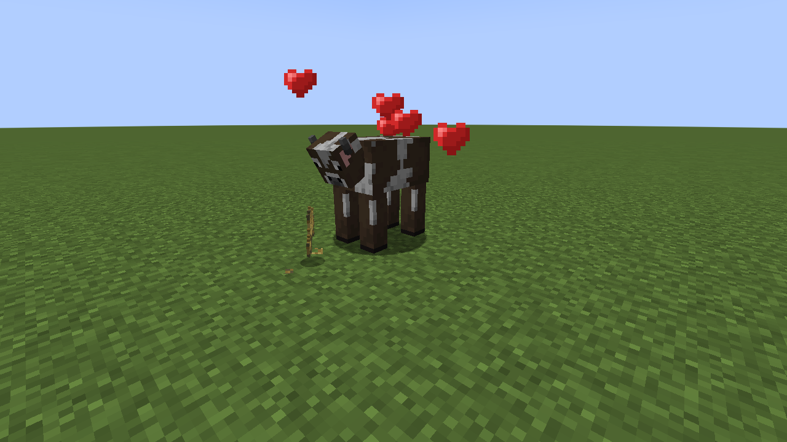

# Eat · 开饭

## AI disclosure

AI was used extensively during the development of this mod. Issues may still occur with different mod combinations and environments. If you do not trust AI-assisted projects, please think carefully before downloading and using it.

## Description

Let animals eat dropped food and feed other players.

## Features

- Drop suitable food near animals. They walk over, chew, and receive the original feeding effect.
- Breeding, growth, healing and taming follow the animal’s own feeding rules. Sitting pets can eat food within reach.
- Food shrinks during chewing, with eating sounds and particles. An interrupted meal returns the unfinished serving.
- Right-click another player with food to give them one serving. The recipient needs at least one empty hand and can interrupt by attacking or sneaking.

## Installation

Install on both the client and server. Choose Forge 1.20.1, Fabric 1.20.1, or NeoForge 1.21.1. Fabric also requires Fabric API.

## Configuration

File: `config/eat.json`. Restart the game or server after editing.

- `groundFeeding`: enable animals eating dropped food. Default: `true`.
- `playerFeeding`: enable feeding other players. Default: `true`.
- `excludedEntities`: entity IDs excluded from ground feeding, for example `["minecraft:cow"]`. Default: `[]`.

Custom feeding systems or models in other mods may need separate compatibility work.

## Links

[Source code](https://github.com/Rotten-flower/eat) · [Issues](https://github.com/Rotten-flower/eat/issues)

If you encounter any issues, please leave a comment or join our QQ group. Include your Minecraft version, mod version, mod loader, and logs whenever possible to help us investigate. Suggestions are also welcome! Your feedback will help guide improvements in future updates.

QQ group: 1095622706

Support the author: [Afdian](https://afdian.com/a/lbcm233)

[Build instructions](BUILDING.md) · [Contributing](CONTRIBUTING.md) · [MIT License](LICENSE)

# 中文

## 制作说明

在该模组开发过程中广泛使用了人工智能。不同的模组组合和环境仍可能出现问题。如果你不相信AI辅助项目，下载使用前请三思。

## 简介

让动物吃地上的食物，也能给其他玩家喂食。

## 功能

- 将合适的食物丢在动物附近，它们会走过去，咀嚼后获得原有的喂食效果。
- 繁殖、成长、回血和驯服沿用动物本身的规则。坐下的宠物可以吃身边够得到的食物。
- 咀嚼时食物逐渐缩小，并播放进食音效和碎屑。进食中断后，未吃完的一份回到地面。
- 手持食物右键其他玩家即可喂食。对方需要至少一只空手，可以通过攻击或潜行中断进食。

## 安装

客户端和服务器均需安装。支持 Forge 1.20.1、Fabric 1.20.1、NeoForge 1.21.1。Fabric 还需要 Fabric API。

## 配置

文件：`config/eat.json`，修改后重新启动游戏或服务器。

- `groundFeeding`：动物吃地上的食物，默认开启。
- `playerFeeding`：给其他玩家喂食，默认开启。
- `excludedEntities`：不参与地面喂食的生物 ID，例如 `["minecraft:cow"]`，默认留空。

其他模组的独立喂食系统或自定义模型可能需要单独适配。

## 反馈与支持

遇到问题可在评论区或 QQ 群反馈，并尽量提供 Minecraft 版本、模组版本、加载器和日志，方便排查。 欢迎提出改进建议，反馈将用于后续更新。

QQ 交流群：1095622706

支持作者：[爱发电](https://afdian.com/a/lbcm233)
